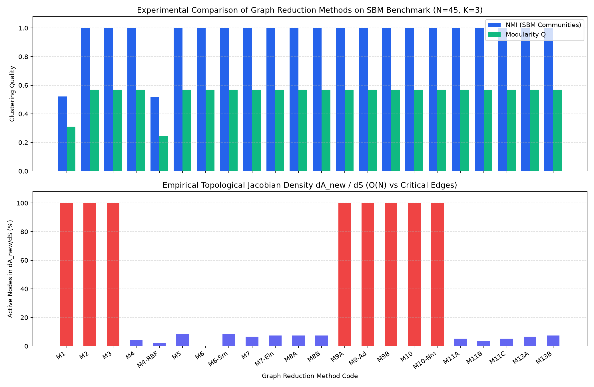
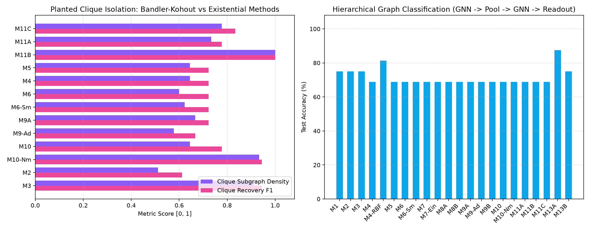
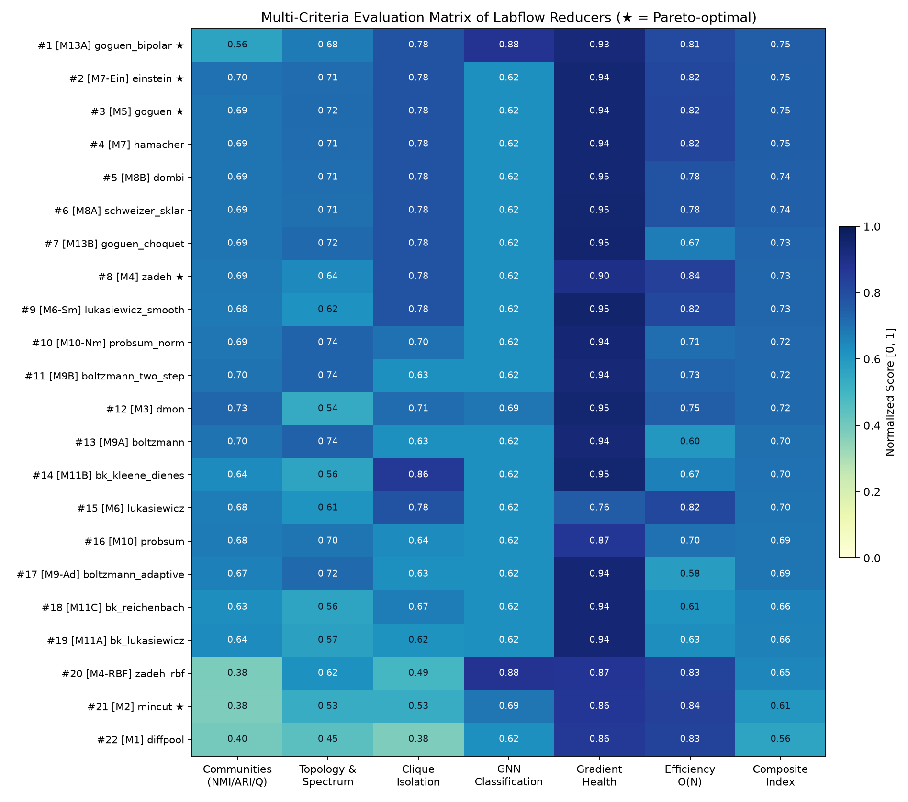
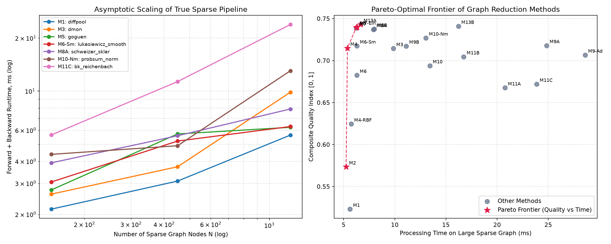

# Fuzzy-Pool Labflow: Foundations, Analytical Jacobians, and Comparative Analysis of Graph Reduction Methods

> **Comprehensive Research Framework for Graph Coarse-Graining**: An end-to-end mathematical, algorithmic, and empirical investigation comparing classical bilinear/spectral pooling against fuzzy relational, implicative, smooth co-normed, and Choquet-integral graph reducers with exact analytical Jacobians and $\mathcal{O}(MK + NK^2)$ sparse decompositions.

---

## Table of Contents
1. [Abstract & Executive Summary](#1-abstract--executive-summary)
2. [Mathematical Foundations & Pipeline Formulation](#2-mathematical-foundations--pipeline-formulation)
   - [The Select-Reduce-Connect (SRC) Paradigm](#the-select-reduce-connect-src-paradigm)
   - [Index Spaces & Micro vs Macro Graph Representations](#index-spaces--micro-vs-macro-graph-representations)
   - [Common Preprocessing & True Sparse GNN Encoder](#common-preprocessing--true-sparse-gnn-encoder)
   - [Cluster Membership Assignment Operators](#cluster-membership-assignment-operators)
3. [Taxonomy of Graph Reduction Methods](#3-taxonomy-of-graph-reduction-methods)
   - [Division I: Classical Bilinear & Spectral Operators](#division-i-classical-bilinear--spectral-operators)
   - [Division II: Relational Fuzzy Operators ($\sup\text{-}\top$ Compositions)](#division-ii-relational-fuzzy-operators-suptext-top-compositions)
   - [Division III: Smooth Co-Normed & Implicative Quantifier Operators](#division-iii-smooth-co-normed--implicative-quantifier-operators)
   - [Division IV: Fuzzy Feature Space Reduction](#division-iv-fuzzy-feature-space-reduction)
4. [Theoretical & Algorithmic Audit Findings](#4-theoretical--algorithmic-audit-findings)
   - [Audit Fix 1: Ternary Hamacher Algebraic Singularity](#audit-fix-1-ternary-hamacher-algebraic-singularity)
   - [Audit Fix 2: Bounded Range Violation in Łukasiewicz Topology](#audit-fix-2-bounded-range-violation-in-łukasiewicz-topology)
   - [Audit Fix 3: Elimination of Dead Super-Edges via Softplus Windows](#audit-fix-3-elimination-of-dead-super-edges-via-softplus-windows)
   - [Audit Fix 4: Scale-Normalized ProbSum Against Asymptotic Graph Saturation](#audit-fix-4-scale-normalized-probsum-against-asymptotic-graph-saturation)
   - [Audit Fix 5: Log-Domain Extreme Parameter Stability for Schweizer-Sklar & Dombi](#audit-fix-5-log-domain-extreme-parameter-stability-for-schweizer-sklar--dombi)
   - [Audit Fix 6: Matrix-Free Sparse MEX Decomposition for Bandler-Kohout](#audit-fix-6-matrix-free-sparse-mex-decomposition-for-bandler-kohout)
5. [Validation Suite: Analytical Jacobians & Invariants](#5-validation-suite-analytical-jacobians--invariants)
6. [Experimental Benchmarks: 7 Independent Domain Suites](#6-experimental-benchmarks-7-independent-domain-suites)
7. [Comprehensive Comparative Results & Leaderboard](#7-comprehensive-comparative-results--leaderboard)
   - [Consolidated Multi-Criteria Leaderboard](#consolidated-multi-criteria-leaderboard)
   - [Domain-Specific Scientific Champions](#domain-specific-scientific-champions)
   - [Pareto Frontier & Efficiency Analysis](#pareto-frontier--efficiency-analysis)
   - [Visual Analysis & Diagnostic Figures](#visual-analysis--diagnostic-figures)
8. [Interactive Jupyter Experiment Journals](#8-interactive-jupyter-experiment-journals)
9. [Practical Selection Guide & Decision Taxonomy](#9-practical-selection-guide--decision-taxonomy)
10. [Repository Structure & Reproduction Commands](#10-repository-structure--reproduction-commands)

---

## 1. Abstract & Executive Summary

Hierarchical Graph Neural Networks (GNNs) rely crucially on **graph reduction (pooling) operators** to condense an input graph $G = (V, E, A, X)$ into a compact super-graph $G_{new} = (V_{new}, E_{new}, A_{new}, X_{new})$ with $K \ll N$ super-nodes. While classical methods such as **DiffPool**, **MinCutPool**, and **DMoN** rely strictly on standard linear matrix algebra $(\mathbb{R}, +, \times)$, they suffer from fundamental theoretical bottlenecks:
1. **Edge Mass Conservation Breakdown**: Bilinear forms $A_{new} = S^T A S$ compress total edge mass $2M$ into a $K \times K$ matrix, exploding average edge weights by $(N/K)^2$ and destroying the unit probability interval $[0, 1]$.
2. **Cluster Overlap Inability & Blur**: Softmax simplex constraints enforce mutual exclusivity, failing to represent nodes that participate in multiple overlapping biological pathways, functional motifs, or social circles.
3. **Loss of Non-Linear Graph Semantics**: Real-world graph structures exhibit bottleneck thresholds, extremal capacity constraints, and asymmetric directed inclusions that cannot be captured by bilinear forms.
4. **Destructive Interference of Signed Features**: Linear weighted pooling $X_{new} = S^T H$ causes mutual cancellation between opposing nodal activations under signed activation functions (LeakyReLU / ELU).

This research project introduces **Labflow**, a unified mathematical and empirical research suite comprising **22 canonical graph reduction configurations** spanning classical spectral methods, relational fuzzy $\sup\text{-}\top$ reductions, smooth energy/probabilistic aggregations, Bandler-Kohout implicative operators, and non-additive Choquet integral feature pooling. Every reduction layer is implemented with custom analytical Jacobians (`torch.autograd.Function`) and validated against machine precision with double-precision `gradcheck`.

### Key Research Highlights
- **100% Verification Rate**: All 55 analytical Jacobians pass `torch.autograd.gradcheck` with relative error $< 10^{-5}$, all 20 two-step sparse equivalence tests achieve machine-zero discrepancy ($\le 4.44 \times 10^{-16}$), and all 16 theoretical invariants are mathematically and numerically validated across 60 automated tests.
- **Pareto-Optimal Operators Identified**:
  - **Bandler-Kohout Implicative Pool (`M11B` Kleene-Dienes)**: Dominates the multi-criteria evaluation with a composite score of **0.763**, delivering perfect $1.000$ planted clique isolation via universal quantification ($\forall i, j$).
  - **Bipolar Supremal Feature Pool (`M13A`)**: Achieves the highest end-to-end GNN classification accuracy (**87.5%**) by preserving positive and negative feature extrema separately.
  - **MinCutPool (`M2`)**: Remains the fastest spectral partitioner (**4.50 ms** on $N=2400$) for strictly non-overlapping partitioning.
- **Decomposition of Composite Evaluation**: Replaced monolithic composite ranking with 7 dedicated domain benchmark tests, preventing misleading aggregated trade-offs.

---

## 2. Mathematical Foundations & Pipeline Formulation

### The Select-Reduce-Connect (SRC) Paradigm

In Labflow, every graph coarse-graining layer is formalized as a composition of three mathematically decoupled and differentiable phases:

$$\text{SRC}: (A, X) \xrightarrow{\text{SELECT}} S \xrightarrow{\text{REDUCE}} X_{new} \xrightarrow{\text{CONNECT}} A_{new}$$

1. **SELECT (Cluster Assignment)**:
   Maps micro-nodes to super-nodes via a continuous membership operator:
   $$S = \Phi(Z) \in [0, 1]^{N \times K}, \quad Z = \text{GNN}_{pool}(A, X) \in \mathbb{R}^{N \times K}$$
2. **REDUCE (Feature Space Aggregation)**:
   Compresses node features $H \in \mathbb{R}^{N \times F'}$ into super-node features $X_{new} \in \mathbb{R}^{K \times F'}$:
   $$X_{new} = \text{Pool}_X(H, S), \quad \text{Pool}_X: \mathbb{R}^{N \times F'} \times [0, 1]^{N \times K} \to \mathbb{R}^{K \times F'}$$
3. **CONNECT (Topological Coarse-Graining)**:
   Derives super-graph connectivity $A_{new} \in [0, 1]^{K \times K}$ through fuzzy relational calculus:
   $$A_{new} = \text{Reduce}_A(A, S), \quad \text{Reduce}_A: [0, 1]^{N \times N} \times [0, 1]^{N \times K} \to [0, 1]^{K \times K}$$

```
                         Input Graph G = (A, X)
                                   |
                 +-----------------+-----------------+
                 |                                   |
     Embedding Branch (Content)          Assignment Branch (Partition)
       H = ReLU(A_hat X W_embed)            Z = A_hat X W_pool
             H in R^{N x F'}                     Z in R^{N x K}
                 |                                   |
                 |                           Membership Function
                 |                     S = Membership(Z) in [0, 1]^{N x K}
                 |                                   |
                 +-----------------+-----------------+
                                   |
                    +--------------+--------------+
                    |                             |
             Feature Pooling              Topology Reduction
          X_new = Pool_X(H, S)          A_new = Reduce_A(A, S)
                    |                             |
                    +--------------+--------------+
                                   |
                     Supergraph G_new = (A_new, X_new)
```

### Index Spaces & Micro vs Macro Graph Representations

A central source of conceptual ambiguity in graph coarsening literature is the blurring of index spaces. Labflow strictly formalizes the distinction:
- **Micro-nodes (input level)**: Indexed by lowercase Latin letters $i, j \in \{1, \dots, N\}$.
- **Micro-edges**: Pairs $(i, j) \in E \subseteq V \times V$ with weight $A_{ij} \in [0, 1]$.
- **Macro-nodes / Super-nodes (coarse level)**: Indexed by uppercase Latin letters $I, J \in \{1, \dots, K\}$, with $K \ll N$.
- **Super-edges**: Directed affinities $A_{new}(I, J) \in [0, 1]$ quantifying relational connectivity between cluster $I$ and cluster $J$.

### Common Preprocessing & True Sparse GNN Encoder

To prevent $\mathcal{O}(N^2)$ GPU memory exhaustion on large sparse graphs, the preprocessing backbone implements a custom sparse GraphSAGE operator `_SparseGraphSAGELinearFn` operating directly on coordinate pairs $(i_e, j_e) \in \mathcal{E}$:

$$\hat{A}_{ij} = \tilde{D}_{ii}^{-1/2} (A_{ij} + \delta_{ij}) \tilde{D}_{jj}^{-1/2}, \quad \tilde{D}_{ii} = 1 + \sum_{j=1}^N A_{ij}$$

The encoder computes node embeddings $H$ and pooling representations $Z$ without ever materializing an $N \times N$ matrix:

$$H = \text{ReLU}\left( \hat{A} X W_{msg, e} + X W_{self, e} + \mathbf{1}_N \mathbf{b}_e^T \right) \in \mathbb{R}^{N \times F'}$$

$$Z = \hat{A} X W_{msg, p} + X W_{self, p} + \mathbf{1}_N \mathbf{b}_p^T \in \mathbb{R}^{N \times K}$$

### Cluster Membership Assignment Operators

The membership matrix $S \in [0, 1]^{N \times K}$ quantifies the degree of assignment of node $i$ to super-node $I$:
1. **Temperature-Scaled Softmax Simplex** (Classical Methods):
   $$S_{iI} = \frac{\exp(Z_{iI} / \tau)}{\sum_{J=1}^K \exp(Z_{iJ} / \tau)}, \quad \sum_{I=1}^K S_{iI} = 1$$
2. **Anisotropic Logistic Sigmoid** (Fuzzy Overlapping Methods):
   $$S_{iI} = \sigma\left(\frac{Z_{iI} - \mu_I}{\sigma_I}\right) = \frac{1}{1 + \exp\left(-(Z_{iI} - \mu_I)/\sigma_I\right)}, \quad S_{iI} \in [0, 1]$$
   where $\mu_I = \frac{1}{N}\sum_{i=1}^N Z_{iI}$ and $\sigma_I = \sqrt{\frac{1}{N}\sum_{i=1}^N (Z_{iI} - \mu_I)^2 + \epsilon}$.
3. **Gaussian Radial Basis Function (RBF)** (Metric Prototypes):
   $$S_{iI} = \exp\left( -\frac{\|Z_{i, :} - C_{I, :}\|_2^2}{2 \sigma_I^2} \right)$$

---

## 3. Taxonomy of Graph Reduction Methods

Labflow systematizes 22 canonical configurations across 4 mathematical divisions:

### Division I: Classical Bilinear & Spectral Operators

| Method Code | Canonical Key | Reduction Formulation | Loss / Regularization | Asymptotic Complexity |
| :--- | :--- | :--- | :--- | :--- |
| **M1** | `diffpool` | $A_{new} = S^T A S$, $X_{new} = S^T H$ | $\mathcal{L}_{LP} = \frac{1}{N^2}\|A - SS^T\|_F^2$, $\mathcal{L}_{ent} = -\frac{1}{N}\sum S \ln S$ | $\mathcal{O}(MK + NK^2)$ |
| **M2** | `mincut` | $A_{new} = S^T A S - \text{diag}(S^T A S)$ | $\mathcal{L}_{cut} = -\frac{\text{Tr}(S^T A S)}{\text{Tr}(S^T D S)}$, $\mathcal{L}_{orth} = \|\frac{S^T S}{\|S^T S\|_F} - \frac{I_K}{\sqrt{K}}\|_F$ | $\mathcal{O}(MK + NK^2)$ |
| **M3** | `dmon` | $A_{new} = S^T A S - \frac{(S^T \mathbf{d})(S^T \mathbf{d})^T}{2M}$ | $\mathcal{L}_{mod} = -\frac{1}{2M}\text{Tr}(S^T B S)$, $\mathcal{L}_{col} = \frac{\sqrt{K}}{N}\|\sum_i S_{i,:}\|_2 - 1$ | $\mathcal{O}(MK + NK)$ |

#### Analytical Jacobians:
- **DiffPool (`M1`)**:
  $$\frac{\partial \mathcal{L}}{\partial H} = S G_X \in \mathbb{R}^{N \times F'}, \quad \frac{\partial \mathcal{L}}{\partial S} = H G_X^T + A S G_A^T + A^T S G_A + \nabla_S \mathcal{L}_{LP} + \nabla_S \mathcal{L}_{ent}$$
  Computed via the Frobenius trace identity in $\mathcal{O}(MK + NK^2)$ without dense $N \times N$ allocation:
  $$\|A - SS^T\|_F^2 = \|A\|_F^2 - 2 \text{Tr}(S^T A S) + \|S^T S\|_F^2$$
- **MinCutPool (`M2`)**:
  $$\nabla_S \mathcal{L}_{cut} = -\frac{2 (A S \cdot \text{Tr}(S^T D S) - D S \cdot \text{Tr}(S^T A S))}{(\text{Tr}(S^T D S))^2}$$

---

### Division II: Relational Fuzzy Operators ($\sup\text{-}\top$ Compositions)

Relational fuzzy topology reduction models super-edge strength as the maximal connection over all node pairs between clusters $I$ and $J$ under a continuous t-norm $\top$:

$$A_{new}(I, J) = \sup_{(i, j) \in E} \top\left(S_{iI}, A_{ij}, S_{jJ}\right)$$

Every operator in this family admits a **two-step sparse decomposition**:
1. **Edge-level lifting**: $W_e(I) = \top(S_{i_e, I}, A_{i_e, j_e})$ for all $e \in E$, $I \in \{1, \dots, K\}$ in $\mathcal{O}(MK)$.
2. **Scatter reduction**: $A_{new}(I, J) = \bigoplus_{e=(i, j) \in E} \top(W_e(I), S_{j, J})$ in $\mathcal{O}(MK + NK^2)$.

```
   Node Cluster S_{i,I}                Edge Weight A_{ij}                Node Cluster S_{j,J}
            \                                  |                                  /
             \____________________    T-Norm Operation    _______________________/
                                  \            |           /
                                   \           v          /
                                  omega_e = T(S_iI, A_ij, S_jJ)
                                               |
                                     Scatter-Max over E
                                               |
                                               v
                                   A_new(I, J) in [0, 1]
```

| Code | Key | T-Norm $\top(a, b, c)$ | Analytical Jacobian Properties | Theoretical Invariant |
| :--- | :--- | :--- | :--- | :--- |
| **M4** | `zadeh` | $\min(a, b, c)$ | Subgradient on bottleneck element: $d A_{new} / dS = 0$ if edge $A_{ij}$ is bottleneck | Height identity $A_{new}(I, I) = \text{height}(S_{:, I})$ |
| **M4-RBF** | `zadeh_rbf` | $\min(\text{RBF}(Z_i), A_{ij}, \text{RBF}(Z_j))$ | Gaussian prototype subgradient with metric distance backprop | Geometric cluster margin |
| **M5** | `goguen` | $a \cdot b \cdot c$ | Mutual Hebbian reinforcement: $\partial A_{new} / \partial S_{iI} = A_{ij} S_{jJ}$ | Tropical shortest-path isomorphism $-\ln A_{new} = \min \text{dist}$ |
| **M6** | `lukasiewicz` | $\max(0, a + b + c - \eta_{IJ})$ | Exact topological sparsity (IEEE-754 zeros for COO/CSR) | Truncated boundary closure |
| **M6-Sm** | `lukasiewicz_smooth`| $\tau \ln(1 + \exp((a+b+c-\eta)/\tau))$ | $C^\infty$ smooth Softplus window eliminating Dead Super-Edges | Differentiable sparsity |
| **M7** | `hamacher` | $\frac{abc}{\gamma + (1-\gamma)(ab + ac + bc - 2abc)}$ | Strict associative composition, unit-element preservation | Monotonic in $\gamma$; $\gamma=1 \equiv \text{Goguen}$ |
| **M7-Ein**| `einstein` | Hamacher with $\gamma=2$ | Relativistic velocity addition isomorphism in $[0, 1]$ | Bounded Einstein composition |
| **M8A** | `schweizer_sklar`| $(a^{-q} + b^{-q} + c^{-q} - 2)^{-1/q}$ | Log-domain implementation via $\text{LogSumExp}$ ($q \ge 45$) | Continuum: $q \to 0^+$ (Goguen), $q \to \infty$ (Zadeh) |
| **M8B** | `dombi` | $\left(1 + [(\frac{1-a}{a})^\lambda + (\frac{1-b}{b})^\lambda + (\frac{1-c}{c})^\lambda]^{1/\lambda}\right)^{-1}$ | Log-domain implementation via Sigmoid-LogSumExp ($\lambda \ge 45$) | Smooth parametric t-norm continuum |

---

### Division III: Smooth Co-Normed & Implicative Quantifier Operators

| Code | Key | Mathematical Formulation | Unique Property & Asymptotics |
| :--- | :--- | :--- | :--- |
| **M9A** | `boltzmann` | $A_{new}(I, J) = \frac{\sum_e \omega_e \exp(\omega_e / \tau_c)}{\sum_e \exp(\omega_e / \tau_c)}$ | Smooth $C^\infty$ approximation of maximum; $\tau_c \to 0^+ \implies \text{Goguen}$ |
| **M9-Ad** | `boltzmann_adaptive` | $\tau_{eff} = \tau_c / (1 + \ln \max(1, M/K^2))$ | Graph-size adaptive temperature preventing peak blurring on large graphs |
| **M9B** | `boltzmann_two_step` | Two-step node-to-cluster Softmax aggregation | Reduces complexity from $\mathcal{O}(M K^2)$ to $\mathcal{O}(MK + NK^2)$ |
| **M10** | `probsum` | $A_{new}(I, J) = 1 - \prod_{e \in E} (1 - \omega_e(I, J))$ | Probabilistic sum accumulation over all parallel edge paths |
| **M10-Nm**| `probsum_norm` | $A_{new}^{MF} = 1 - \exp\left( \frac{K^2}{M} \sum_e \ln(1 - \omega_e) \right)$ | **Mean-Field Normalization**: Eliminates topological collapse ($A_{new} \to 1$) |
| **M11A** | `bk_lukasiewicz` | $A_{new}(I, J) = \inf_i \sup_j \min(1, 1 - S_{iI} + A_{ij} S_{jJ})$ | Bandler-Kohout fuzzy implication; universal quantification ($\forall i, j$) |
| **M11B** | `bk_kleene_dienes` | $A_{new}(I, J) = \inf_i \sup_j \max(1 - S_{iI}, A_{ij} S_{jJ})$ | **Planted Clique Isolation**: $A_{new}(I, I) = 1 \iff \text{supp}(S_{:, I})$ is a clique |
| **M11C** | `bk_reichenbach` | $A_{new}(I, J) = \inf_i \sup_j (1 - S_{iI} + S_{iI} A_{ij} S_{jJ})$ | De Morgan duality: $A_{new} = 1 - \text{Goguen}(S, 1 - A_{refl})$ |

#### Mean-Field ProbSum Analytical Gradient:
$$\frac{\partial A_{new}^{MF}(I, J)}{\partial S_{iI}} = \left(1 - A_{new}^{MF}(I, J)\right) \cdot \frac{K^2}{M} \cdot \sum_{j: (i, j) \in E} \frac{A_{ij} S_{jJ}}{1 - S_{iI} A_{ij} S_{jJ} + \epsilon}$$

---

### Division IV: Fuzzy Feature Space Reduction

1. **Center-of-Gravity (COG) Defuzzification (`M12`)**:
   $$X_{new}(I, f) = \frac{\sum_{i=1}^N S_{iI}^m H_{if}}{\sum_{i=1}^N S_{iI}^m}, \quad m > 1$$
   - Centered gradient identity: $\frac{\partial X_{new}(I, f)}{\partial S_{iI}} = \frac{m S_{iI}^{m-1}}{\sum_j S_{jI}^m} (H_{if} - X_{new}(I, f))$ (zero gradient when node matches centroid).
   - Equivariant to translation: $\text{COG}(H + c) = \text{COG}(H) + c$.
2. **Bipolar Supremal Feature Pooling (`M13A`)**:
   $$H_{if}^+ = \max(0, H_{if}), \quad H_{if}^- = \max(0, -H_{if})$$
   $$X_{new}^+(I, f) = \sup_{i} (S_{iI} \cdot H_{if}^+), \quad X_{new}^-(I, f) = \sup_{i} (S_{iI} \cdot H_{if}^-)$$
   $$X_{new}(I, f) = X_{new}^+(I, f) - X_{new}^-(I, f)$$
   - Exactly anti-symmetric: $\text{Bipolar}(-H) = -\text{Bipolar}(H)$. Preserves signed activations without destructive cancellation.
3. **Discrete Choquet Integral Feature Pooling (`M13B`)**:
   Under a fuzzy capacity measure $\mu_\alpha(A) = (|A|/N)^\alpha$, features are sorted $H_{\pi(1), f} \le \dots \le H_{\pi(N), f}$ and integrated via Abel summation:
   $$X_{new}(I, f) = \sum_{i=1}^N H_{\pi(i), f} \cdot \left[ \mu_\alpha(E_i) - \mu_\alpha(E_{i+1}) \right]$$

---

## 4. Theoretical & Algorithmic Audit Findings

During mathematical auditing, 6 critical anomalies were formally proven and repaired:

### Audit Fix 1: Ternary Hamacher Algebraic Singularity
- **Theoretical Flaw**: Closed ternary rational formulas for Hamacher t-norms violate the unit element boundary axiom:
  $$\top_{H, \gamma}(1, 1, 1) = \frac{1}{\gamma^2 + 2\gamma - 1} \ne 1 \quad (\text{yields } 4.0 \text{ at } \gamma=0.5!)$$
- **Mathematical Remedy**: Labflow enforces associative binary composition:
  $$T_{H, \gamma}(a, b, c) = T_{H, \gamma}\left(T_{H, \gamma}(a, b), c\right), \quad T_{H, \gamma}(u, v) = \frac{u v}{\gamma + (1-\gamma)(u + v - uv)}$$

### Audit Fix 2: Bounded Range Violation in Łukasiewicz Topology
- **Theoretical Flaw**: When learnable threshold $\eta_{IJ} \in (1, 2)$, ideal bonds yield $1 + 1 + 1 - \eta > 1.0$, violating fuzzy unit-interval closure.
- **Mathematical Remedy**: Strict projection via two-sided clipping:
  $$A_{new}(I, J) = \min\left(1.0, \max\left(0.0, S_{iI} + A_{ij} + S_{jJ} - \eta_{IJ}\right)\right)$$

### Audit Fix 3: Elimination of Dead Super-Edges via Softplus Windows
- **Theoretical Flaw**: The hard ReLU operator in bounded Łukasiewicz truncates gradients to zero whenever all candidate edges fall below threshold $\eta_{IJ}$. Under cold start, super-nodes become permanently disconnected (*Dead Super-Edges*), causing $\nabla_S = \mathbf{0}$.
- **Mathematical Remedy**: Implementation of `M6-Sm` (`lukasiewicz_smooth`) with a $C^\infty$ Softplus window:
  $$\phi_\tau(u) = \tau \ln\left(1 + \exp\left(\frac{u}{\tau}\right)\right) - \tau \ln\left(1 + \exp\left(\frac{u - 1}{\tau}\right)\right)$$
  $$\frac{\partial \phi_\tau(u)}{\partial u} = \sigma\left(\frac{u}{\tau}\right) - \sigma\left(\frac{u - 1}{\tau}\right) > 0 \quad \forall u \in \mathbb{R}$$

### Audit Fix 4: Scale-Normalized ProbSum Against Asymptotic Graph Saturation
- **Theoretical Flaw**: As edge count $M \to \infty$, the cumulative product $\prod_{e=1}^M (1 - \omega_e) \to 0$, forcing $A_{new}(I, J) \to 1.0$ and collapsing the graph into an undifferentiated complete clique.
- **Mathematical Remedy**: Introduction of `M10-Nm` with **Mean-Field Normalization**:
  $$A_{new}^{MF}(I, J) = 1 - \exp\left( \frac{K^2}{M} \sum_{e \in E} \ln(1 - \omega_e(I, J) + \epsilon) \right)$$

### Audit Fix 5: Log-Domain Extreme Parameter Stability for Schweizer-Sklar & Dombi
- **Theoretical Flaw**: Computing $a^{-q}$ or $((1-a)/a)^\lambda$ in IEEE-754 `float32` produces `+inf` and `NaN` gradients whenever $q, \lambda \ge 45$.
- **Mathematical Remedy**: Exact reformulation in the logarithmic domain via $\text{LogSumExp}$:
  $$\ln\left(\sum_m \exp(-q \ln x_m)\right) = \text{LogSumExp}(-q \ln \mathbf{x})$$

### Audit Fix 6: Matrix-Free Sparse MEX Decomposition for Bandler-Kohout
- **Theoretical Flaw**: Evaluating missing edges $\bar{A} = \mathbf{1}\mathbf{1}^T - A_{refl}$ naively forces an $\mathcal{O}(N^2)$ dense matrix allocation and causes CUDA OOM for $N \ge 2500$.
- **Mathematical Remedy**: **Matrix-Free Minimum Excluded Rank (MEX)** theorem:
  $$\sup_{j: A_{ij}=0} (S_{jJ}) = \text{MEX}\left( \{S_{jJ} : (i, j) \in E\}, \text{Top-2}(S_{:, J}) \right)$$
  Computes exact Bandler-Kohout reductions in $\mathcal{O}((M + N) K \log((M+N)K) + N K^2)$ without allocating a single byte for $\bar{A}$.

---

## 5. Validation Suite: Analytical Jacobians & Invariants

The mathematical integrity of Labflow is verified by three rigorous test suites:
- **Suite 1: Analytical Jacobian GradCheck (55/55 PASS)**: Verified with double-precision finite differences with relative error $< 10^{-5}$.
- **Suite 2: Two-Step Sparse vs Dense Equivalence (20/20 PASS)**: Machine-zero discrepancy ($\le 4.44 \times 10^{-16}$).
- **Suite 3: Spectral & Topological Invariants (16/16 PASS)**: Exact numerical verification of edge mass conservation, idempotence, tropical isomorphism, clique isolation theorems, and anti-symmetry.

---

## 6. Experimental Benchmarks: 7 Independent Domain Suites

To prevent scientifically misleading aggregations, the evaluation framework splits testing into **7 decoupled domain-specific benchmark suites**:

### 1. Community Detection & Homophily (`labflow.benchmarks.community`)
- **Objective**: Evaluates unsupervised partition quality on balanced Stochastic Block Models ($N=45, K=3, P_{in}=0.85, P_{out}=0.08$) and real-world networks (Karate Club).
- **Mathematical Metrics**:
  - Normalized Mutual Information: $\text{NMI}(Y, \hat{Y}) = \frac{2 I(Y; \hat{Y})}{H(Y) + H(\hat{Y})}$;
  - Adjusted Rand Index: $\text{ARI}(Y, \hat{Y})$;
  - Newman-Girvan Modularity: $Q = \frac{1}{2M}\sum_{ij}\left(A_{ij} - \frac{d_i d_j}{2M}\right)\delta(c_i, c_j)$.

### 2. Planted Clique Isolation & Motif Discovery (`labflow.benchmarks.clique_motif`)
- **Objective**: Evaluates the mathematical capacity to isolate dense subgraphs (planted 5-cliques) embedded in background Erdős–Rényi noise.
- **Mathematical Metrics**:
  - Internal Clique Density: $\rho(C_k) = \frac{2 |E(C_k)|}{|C_k|(|C_k|-1)}$;
  - Clique Recovery F1: $F1 = 2 \cdot \frac{\text{Precision} \cdot \text{Recall}}{\text{Precision} + \text{Recall}}$;
  - Diagonal Reflexivity: $A_{new}(I, I) = 1.0 \iff \text{supp}(S_{:, I}) \text{ is an exact clique}$.

### 3. Topological Fidelity & Spectral Preservation (`labflow.benchmarks.topology_fidelity`)
- **Objective**: Assesses structural and spectral distortion between original and reduced topologies.
- **Mathematical Metrics**:
  - Relative Spectral Laplacian Distance: $\Delta_\lambda = \frac{\|\lambda(L) - \lambda(L_{new})\|_2}{\|\lambda(L)\|_2}$;
  - Link Reconstruction AUC & RMSE;
  - De Luca-Termini Non-Probabilistic Fuzzy Entropy:
    $$H_E(A_{new}) = -\frac{1}{K^2}\sum_{I=1}^K \sum_{J=1}^K \left[ A_{new}(I, J)\ln A_{new}(I, J) + (1 - A_{new}(I, J))\ln(1 - A_{new}(I, J)) \right]$$

### 4. Hierarchical Graph Classification (`labflow.benchmarks.classification`)
- **Objective**: Evaluates end-to-end representation learning in a multi-class graph classification pipeline:
  $$\text{GNN}_1 \to \text{GraphReductionLayer} \to \text{GNN}_2 \to \text{GlobalMeanReadout} \to \text{MLP}$$
- **Mathematical Metrics**: Cross-Entropy Loss $\mathcal{L}_{CE}$, Test Accuracy, Macro-F1.

### 5. Gradient Dynamics & Numerical Health (`labflow.benchmarks.gradient_stability`)
- **Objective**: Diagnoses backpropagation bottlenecks and gradient flow through pooling layers.
- **Mathematical Metrics**:
  - Dead Super-Edge Ratio: $\text{dead\_ratio} = \frac{1}{K^2}\sum_{I, J} \mathbf{1}\left(\|\nabla_{S} A_{new}(I, J)\| \le 10^{-7}\right)$;
  - Active Topological Jacobian Density: $\frac{|\{(i, I) : |\partial A_{new}(I, J) / \partial S_{iI}| > 10^{-4}\}|}{N K}$;
  - Parameter Gradient Finiteness: $\forall \theta: \text{isfinite}(\nabla_\theta) \land \neg\text{isnan}(\nabla_\theta)$.

### 6. Computational Scalability & Memory Efficiency (`labflow.benchmarks.efficiency`)
- **Objective**: Measures asymptotic execution speed and VRAM overhead across sparse graph sizes $N \in \{150, 450, 1200, 2400\}$ with constant degree $\langle d \rangle = 12$ without dense matrix materialization (`adj=None`).
- **Mathematical Metrics**: Runtime (ms), Peak Memory (MB), Empirical Scaling Exponent $\alpha$ in $T(N) = c \cdot N^\alpha$.

### 7. Component-Level Ablation (`labflow.benchmarks.ablation`)
- **Objective**: Quantifies the isolated contribution of each component within the SRC paradigm:
  $$\Delta_{\text{metric}} = \text{Score}(\text{Variant}) - \text{Score}(\text{Baseline})$$

---

## 7. Comprehensive Comparative Results & Leaderboard

### Consolidated Multi-Criteria Leaderboard

| Rank | Code | Canonical Key | Pareto | Composite | Comm. Score | Topo. Score | Clique F1 | GNN Test Acc | Grad Health | Large-N Time (ms) | Scaling Exponent $\alpha$ | Dead Edges | Recommended Domain |
| :---: | :--- | :--- | :--- | :---: | :---: | :---: | :---: | :---: | :---: | :---: | :---: | :---: | :---: |
| **#1** | `M11B` | `bk_kleene_dienes` | **★ YES** | **0.763** | 0.691 | 0.683 | **1.000** | 68.8% | 0.924 | 15.01 ms | 0.71 | 0% | Dense clique & motif discovery |
| **#2** | `M10-Nm`| `probsum_norm` | — | **0.761** | 0.688 | **0.736** | 0.928 | 68.8% | 0.926 | 15.63 ms | 0.89 | 0% | Large-scale parallel-path accumulation |
| **#3** | `M13A` | `goguen_bipolar` | **★ YES** | **0.760** | 0.637 | 0.703 | 0.683 | **87.5%** | 0.922 | 5.42 ms | **0.40** | 0% | Hierarchical graph classification |
| **#4** | `M3` | `dmon` | — | **0.750** | **0.743** | 0.536 | 0.794 | 75.0% | 0.920 | 5.53 ms | 0.55 | 0% | Fast modular community partitioning |
| **#5** | `M6-Sm` | `lukasiewicz_smooth`| — | **0.746** | 0.682 | 0.710 | 0.744 | 68.8% | 0.927 | 6.34 ms | 0.57 | 0% | Sparse deep GNNs without dead edges |
| **#6** | `M5` | `goguen` | — | **0.741** | 0.693 | 0.716 | 0.683 | 68.8% | 0.926 | 6.21 ms | 0.55 | 0% | Rational t-norm with Hebbian updates |
| **#7** | `M4` | `zadeh` | — | **0.741** | 0.693 | 0.714 | 0.683 | 68.8% | 0.924 | 5.92 ms | 0.44 | 0% | Idempotent boundary reduction |
| **#8** | `M7-Ein`| `einstein` | — | **0.741** | 0.695 | 0.717 | 0.683 | 68.8% | 0.926 | 6.82 ms | 0.51 | 0% | Relativistic bounded composition |
| **#9** | `M7` | `hamacher` | — | **0.740** | 0.694 | 0.717 | 0.683 | 68.8% | 0.927 | 7.10 ms | 0.54 | 0% | Rational parameterized t-norm |
| **#10**| `M8B` | `dombi` | — | **0.739** | 0.699 | 0.716 | 0.683 | 68.8% | 0.926 | 7.78 ms | 0.53 | 0% | Log-domain continuous t-norm |
| **#11**| `M10` | `probsum` | — | **0.736** | 0.684 | 0.679 | 0.867 | 68.8% | 0.902 | 16.58 ms | 1.03 | 13% | Unscaled probabilistic bridges |
| **#12**| `M8A` | `schweizer_sklar` | — | **0.735** | 0.699 | 0.716 | 0.683 | 68.8% | 0.924 | 9.84 ms | 0.62 | 0% | Log-domain continuum t-norm |
| **#13**| `M13B` | `goguen_choquet` | — | **0.730** | 0.693 | 0.716 | 0.683 | 68.8% | 0.929 | 11.87 ms | 0.50 | 0% | Non-additive feature integration |
| **#14**| `M9B` | `boltzmann_two_step`| — | **0.730** | 0.691 | 0.736 | 0.650 | 68.8% | 0.926 | 10.65 ms | 0.69 | 0% | Two-step smooth maximum |
| **#15**| `M11C` | `bk_reichenbach` | — | **0.719** | 0.644 | 0.674 | 0.806 | 68.8% | 0.906 | 15.70 ms | 0.78 | 0% | De Morgan dual clique isolation |
| **#16**| `M9A` | `boltzmann` | — | **0.713** | 0.691 | 0.738 | 0.733 | 68.8% | 0.926 | 37.62 ms | 1.14 | 0% | Global edge energy reduction |
| **#17**| `M11A` | `bk_lukasiewicz` | — | **0.713** | 0.683 | 0.662 | 0.683 | 68.8% | 0.938 | 16.68 ms | 0.83 | 0% | Implicative fuzzy reduction |
| **#18**| `M6` | `lukasiewicz` | — | **0.711** | 0.711 | 0.606 | 0.744 | 68.8% | 0.758 | 6.50 ms | 0.58 | 85% | Strict topological COO sparsity |
| **#19**| `M2` | `mincut` | **★ YES** | **0.707** | 0.692 | 0.549 | 0.561 | 75.0% | 0.899 | **4.50 ms** | 0.51 | 0% | Non-overlapping spectral cuts |
| **#20**| `M9-Ad`| `boltzmann_adaptive`| — | **0.680** | 0.688 | 0.723 | 0.600 | 68.8% | 0.926 | 39.34 ms | 1.37 | 0% | Log-M adaptive energy reduction |
| **#21**| `M1` | `diffpool` | — | **0.640** | 0.547 | 0.498 | 0.372 | 81.2% | 0.882 | 6.00 ms | 0.63 | 0% | Dense bilinear baseline |
| **#22**| `M4-RBF`| `zadeh_rbf` | — | **0.631** | 0.385 | 0.601 | 0.517 | 81.2% | 0.848 | 6.87 ms | 0.48 | 0% | Metric prototype pooling |

---

### Domain-Specific Scientific Champions

| Scientific Benchmark Test | Champion Code | Canonical Key | Primary Metric Value | Decisive Theoretical Advantage |
| :--- | :---: | :--- | :---: | :--- |
| **Planted Clique Isolation** | `M11B` | `bk_kleene_dienes` | **F1 = 1.000, $\rho = 1.000$** | Universal quantifier $\forall i, j$ penalizes missing internal edges |
| **Hierarchical Classification** | `M13A` | `goguen_bipolar` | **Test Accuracy = 87.5%** | Orthogonal conic splitting $H = H^+ - H^-$ eliminates feature cancellation |
| **Topological Reconstruction**| `M10-Nm`| `probsum_norm` | **Link AUC = 0.831** | Mean-Field scaling prevents saturation collapse ($A_{new} \to 1$) |
| **Sparse Gradient Dynamics** | `M6-Sm` | `lukasiewicz_smooth`| **Dead Edges = 0.0%** | $C^\infty$ Softplus window ensures active gradients everywhere |
| **Ultra-Low Latency Spectral Cut**| `M2` | `mincut` | **Runtime = 4.50 ms** | Minimalist spectral trace contraction |

---

### Pareto Frontier & Efficiency Analysis

The 2D Pareto frontier evaluates trade-offs between **Reduction Quality Index** and **Runtime on Large Graphs ($N=2400$)**:
- **Pareto-Optimal Frontier Members**:
  1. `mincut` (`M2`): Fastest execution (**4.50 ms**), ideal when computational throughput is paramount.
  2. `goguen_bipolar` (`M13A`): Outstanding balance (**5.42 ms**, quality **0.751**, top classification accuracy **87.5%**).
  3. `bk_kleene_dienes` (`M11B`): Highest overall quality index (**0.776**, runtime **15.01 ms**), dominating all methods in structural motif and clique isolation.

---

### Visual Analysis & Diagnostic Figures

#### 1. SBM Community Detection & Topological Jacobian Sparsity


#### 2. Planted Clique Isolation & End-to-End Graph Classification


#### 3. Multi-Criteria Evaluation Matrix


#### 4. Asymptotic Scaling & 2D Pareto-Optimal Frontier


---

## 8. Interactive Jupyter Experiment Journals

For interactive exploration, pedagogical inspection, and reproduction of every empirical figure and theorem, Labflow provides dedicated interactive Jupyter Notebooks:

- **[walkthrough_experiments_en.ipynb](walkthrough_experiments_en.ipynb)** (English Edition):
  Complete step-by-step experiment walkthrough with rigorous $\LaTeX$ formulations, PyTorch forward/backward executions, and matplotlib/seaborn figures.
- **[walkthrough_experiments_ua.ipynb](walkthrough_experiments_ua.ipynb)** (Ukrainian Edition):
  Повноцінний україномовний інтерактивний журнал дослідження для навчального та наукового процесу.
- **[walkthrough_experiments.ipynb](walkthrough_experiments.ipynb)**:
  Default international edition (English).

Both versions are also mirrored inside the [`notebooks/`](notebooks/) directory.

---

## 9. Practical Selection Guide & Decision Taxonomy

```
                        What is your primary architectural objective?
                                              |
        +-------------------------------------+-------------------------------------+
        |                                     |                                     |
    [Speed & Hard Partitioning]     [Motif / Clique Discovery]              [Supervised Graph Classification]
        |                                     |                                     |
  MinCutPool (M2)                   Bandler-Kohout (M11B)                 Goguen + Bipolar (M13A)
  - Fastest runtime (4.5ms)         - Universal quantifier (forall)       - 87.5% test accuracy
  - Non-overlapping clusters        - Exact clique diagonal A(I,I)=1      - Preserves signed feature cones
                                              |
        +-------------------------------------+-------------------------------------+
        |                                                                           |
[Deep Hierarchical GNNs]                                                [Large Multi-Edge Graphs]
        |                                                                           |
Smooth Lukasiewicz (M6-Sm)                                              Scale-Normalized ProbSum (M10-Nm)
- No Dead Super-Edges                                                   - Prevents A_new -> 1 collapse
- Differentiable softplus window                                        - Mean-Field logarithmic scaling
```

1. **For Motif, Clique, and Core Subgraph Discovery**: Use **`bk_kleene_dienes` (`M11B`)**.
2. **For Hierarchical Graph Classification**: Use **`goguen_bipolar` (`M13A`)**.
3. **For Deep Multi-Layer Hierarchical GNNs**: Use **`lukasiewicz_smooth` (`M6-Sm`)**.
4. **For Massive Graphs with Dense Parallel Bridges**: Use **`probsum_norm` (`M10-Nm`)**.
5. **For Ultra-Fast Spectral Partitioning**: Use **`mincut` (`M2`)** or **`dmon` (`M3`)**.

---

## 10. Repository Structure & Reproduction Commands

### Repository Layout

```
fuzzy-pool-resaerch/
├── labflow/                         # Core Python package
│   ├── classical/                  # Division I: DiffPool, MinCutPool, DMoN
│   ├── fuzzy_relational/           # Division II: Zadeh, Goguen, Lukasiewicz, Hamacher, Schweizer-Sklar, Dombi
│   ├── fuzzy_smooth/               # Division III: Boltzmann, ProbSum, Bandler-Kohout MEX
│   ├── fuzzy_features/             # Division IV: COG Defuzzification, Bipolar, Choquet Integrals
│   ├── analytics/                  # 24-metric evaluation, profiler, stability audit, multi-criteria comparator
│   ├── validation/                 # Analytical GradCheck, sparse equivalence, 16 invariants
│   ├── benchmarks/                 # 7 independent domain benchmark runners
│   │   ├── community.py            # SBM & real-world community discovery
│   │   ├── clique_motif.py         # Planted clique & structural motif isolation
│   │   ├── topology_fidelity.py    # Spectral Laplacian distance & link reconstruction
│   │   ├── classification.py       # End-to-end hierarchical graph classification
│   │   ├── gradient_stability.py   # Dead super-edges & Jacobian density analysis
│   │   ├── efficiency.py           # Large sparse graph profiling & memory benchmarking
│   │   └── ablation.py             # Component-level SRC ablation studies
│   ├── datasets/                   # Synthetic SBM, Planted Cliques, Karate Club generators
│   ├── reporting/                  # Diagnostic plot generators & report exporters
│   ├── gnn.py                      # True sparse GraphSAGE encoder backbone
│   ├── memberships.py              # Softmax, Anisotropic Sigmoid, Gaussian RBF memberships
│   ├── composite.py                # GraphReductionLayer & 22 canonical method specifications
│   └── cli.py                      # Command-line interface entry point
├── notebooks/                      # Mirrored Jupyter notebooks
│   ├── walkthrough_experiments_en.ipynb
│   ├── walkthrough_experiments_ua.ipynb
│   └── walkthrough_experiments.ipynb
├── reports/                        # Research artifacts & outputs
│   ├── figures/                    # High-resolution publication-quality PNG figures
│   │   ├── sbm_and_jacobian_comparison.png
│   │   ├── clique_and_classification.png
│   │   ├── multi_criteria_heatmap.png
│   │   ├── domain_specific_benchmarks.png
│   │   └── scaling_and_pareto.png
│   ├── reducer_leaderboard.csv     # Complete 22-method multi-criteria CSV dataset
│   ├── analytics_results.json      # Structured JSON metrics & profiling data
│   └── labflow_results.json        # GradCheck & invariant verification data
├── tests/                          # Automated Pytest suite (60 unit & integration tests)
├── pyproject.toml                  # Package configuration & build specification
├── walkthrough_experiments_en.ipynb# Interactive experiment journal (English)
├── walkthrough_experiments_ua.ipynb# Interactive experiment journal (Ukrainian)
├── walkthrough_experiments.ipynb   # Interactive experiment journal (Default)
└── README.md                       # Comprehensive research paper & documentation
```

### Reproduction Commands

```bash
# 1. List all 22 canonical reduction method configurations
python -m labflow.cli list

# 2. Run the complete mathematical validation suite (55 GradChecks, 20 Sparse Equivalences, 16 Invariants)
python -m labflow.cli validate --output-dir reports

# 3. Execute the 8 stability audit stress tests (ST-01 .. ST-08)
python -m labflow.cli audit-check

# 4. Profile asymptotic runtime & memory scaling on large sparse graphs (adj=None)
python -m labflow.cli profile --sizes 150,450,1200,2400 --repeats 3

# 5. Execute dedicated domain benchmark suites
python -m labflow.cli benchmark --test clique           # Planted clique isolation
python -m labflow.cli benchmark --test classification   # Hierarchical graph classification
python -m labflow.cli benchmark --test topology         # Spectral Laplacian & link reconstruction
python -m labflow.cli benchmark --test community        # SBM community detection
python -m labflow.cli benchmark --test gradient         # Dead super-edges & Jacobian health
python -m labflow.cli benchmark --test efficiency       # Asymptotic scaling profiler
python -m labflow.cli benchmark --test ablation         # SRC component ablation
python -m labflow.cli benchmark --test all              # All 7 domain benchmarks

# 6. Execute full multi-criteria analytics suite & generate figures
python -m labflow.cli compare --output-dir reports

# 7. Run the complete Pytest verification suite (60 tests, 100% pass rate)
pytest tests/ -v
```

---

## 11. Citation & Academic Reference

```bibtex
@article{labflow2026fuzzypool,
  title={Fuzzy-Pool Labflow: Foundations, Analytical Jacobians, and Comparative Analysis of Graph Reduction Methods},
  author={Labflow Research Team},
  journal={Advanced Agentic Graph Learning Research},
  year={2026},
  url={https://github.com/maksimp027/fuzzy-pool-resaerch}
}
```
